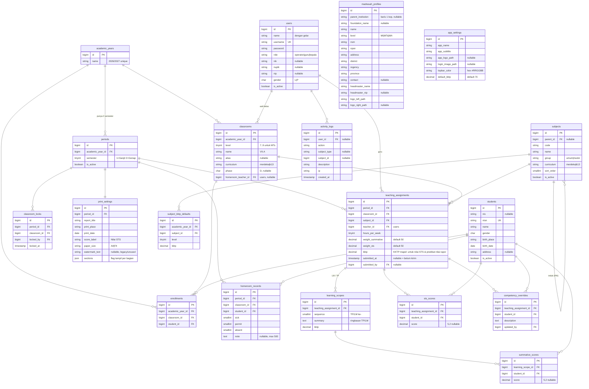

# 03 — ERD & Skema Database

DB: MySQL 8 / MariaDB 10.6+, `utf8mb4_unicode_ci`. Semua tabel punya `id` BIGINT unsigned auto-increment
dan `created_at`/`updated_at` kecuali disebut lain. FK memakai `foreignId()->constrained()`.

## 1. Diagram

## 2. Constraint & index wajib

| Tabel | Constraint |
|---|---|
| madrasah_profiles, app_settings | Tepat satu baris (dibuat seeder; aplikasi hanya update) |
| academic_years | `unique(name)` |
| periods | `unique(academic_year_id, semester)`; tepat satu `is_active = true` (dijaga di service, dalam transaksi) |
| users | `unique(username)`; index `(role, is_active)` |
| subjects | `unique(curriculum, code)`; FK `parent_id` → subjects `nullOnDelete` |
| subject_kktp_defaults | `unique(academic_year_id, subject_id, level)` |
| classrooms | `unique(academic_year_id, name)`; FK homeroom `nullOnDelete` |
| students | `unique(nisn)` |
| enrollments | `unique(academic_year_id, student_id)` (satu siswa satu kelas per tahun); index `(classroom_id)` |
| teaching_assignments | `unique(period_id, classroom_id, subject_id)`; index `(teacher_id, period_id)` |
| learning_scopes | `unique(teaching_assignment_id, sequence)`; FK cascade on delete |
| summative_scores | `unique(learning_scope_id, student_id)`; FK learning_scope cascade |
| sts_scores | `unique(teaching_assignment_id, student_id)` |
| competency_overrides | `unique(teaching_assignment_id, student_id)` |
| homeroom_records | `unique(period_id, student_id)` |
| classroom_locks | `unique(period_id, classroom_id)` — buka kunci = hapus baris + log |
| print_settings | `unique(period_id)` |
| activity_logs | index `(created_at)`, `(user_id)`; tanpa `updated_at` |

Catatan:
- `students` dan `users` tidak dihapus dari UI: pakai `is_active = false` (ADR-011).
- Nilai **tidak** di-cascade dari `students`/`users` (restrict) agar tidak hilang tak sengaja.
- `teaching_assignments.submitted_at` adalah satu-satunya penanda status kirim.
- Kolom desimal memakai `decimal(5,2)`.

## 3. Seed bawaan

1. `madrasah_profiles` & `app_settings`: satu baris berisi placeholder `[NAMA MADRASAH]` dll.
2. User operator: `admin` / password acak yang dicetak ke konsol saat `php artisan db:seed`.
3. Mapel MTs Kurikulum Merdeka (urutan cetak sesuai rapor contoh):
   1. Pendidikan Agama Islam (PAI) — induk, tanpa nilai
      - A. Al Qur'an Hadis (QH) · B. Akidah Akhlak (AA) · C. Fikih (FIK) · D. Sejarah Kebudayaan Islam (SKI)
   2. Bahasa Arab (BAR) 3. Pendidikan Pancasila (PP) 4. Bahasa Indonesia (BIN) 5. Matematika (MTK)
   6. Ilmu Pengetahuan Alam (IPA) 7. Ilmu Pengetahuan Sosial (IPS) 8. Bahasa Inggris (BIG)
   9. Pendidikan Jasmani, Olahraga dan Kesehatan (PJOK) 10. Informatika (INF)
   11. Seni Budaya / Prakarya (SBP) · Muatan Lokal (MULOK) — induk, opsional
4. `DemoSeeder` terpisah (tidak dijalankan di produksi): 1 tahun pelajaran, 3 kelas, 10 guru,
   30 siswa fiktif, nilai acak — untuk demo ke calon klien dan untuk test.

## 4. Query penting (untuk menghindari N+1)

- Halaman Penilaian guru: `TeachingAssignment::with(['learningScopes.scores', 'stsScores',
  'competencyOverrides', 'classroom.enrollments.student'])` lalu hitung di `GradeCalculator`.
- Leger kelas: ambil semua teaching_assignments kelas + relasi di atas dalam satu batch, hitung di
  service, jangan query per sel.
- Dashboard kepala: agregat pakai query `GROUP BY classroom_id` untuk hitungan terkirim; rerata
  dihitung di service dari data yang sudah di-batch per tingkat.
